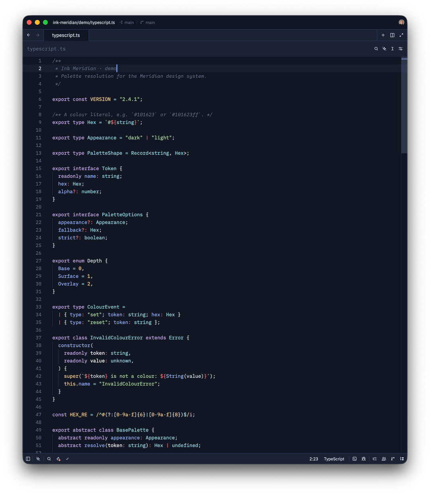

# Ink Meridian

A colour scheme for command-line tools, built from a single palette.

Ink Meridian is a dark, low-contrast navy scheme with a periwinkle accent.
Every tool in this repository renders from the same twenty-two base colours
plus six derived tints, so a file listing, a diff, a syntax-highlighted source
file and a status bar all read as one system.



*TypeScript in Zed — keywords, types, strings, numbers and comments each map to
a distinct palette role.*

| Tool | Scheme | Install path |
| --- | --- | --- |
| [bat](bat/) | TextMate `.tmTheme` | `~/.config/bat/themes/` |
| [eza](eza/) | `theme.yml` | `~/.config/eza/` |
| [fzf](fzf/) | `fzf.conf` | `~/.config/fzf/` |
| [ghostty](ghostty/) | `config` | `~/.config/ghostty/` |
| [lazygit](lazygit/) | `config.yml` | `~/.config/lazygit/` |
| [neovim](neovim/) | Lua colourscheme | `~/.config/nvim/colors/` |
| [opencode](opencode/) | theme JSON | `~/.config/opencode/themes/` |
| [tmux](tmux/) | `tmux.conf` | source from `~/.config/tmux/tmux.conf` |
| [zed](zed/)       | theme JSON | `~/.config/zed/themes/` |
| [tuicr](tuicr/) | theme TOML | `~/.config/tuicr/themes/` |

Each tool has its own directory with the scheme file and a short README
covering installation and verification.

## Install everything

```bash
cd /path/to/ink-meridian

mkdir -p ~/.config/bat/themes ~/.config/eza ~/.config/fzf ~/.config/ghostty ~/.config/zed \
         ~/.config/lazygit ~/.config/nvim/colors ~/.config/opencode/themes ~/.config/tuicr/themes

cp "bat/Ink Meridian.tmTheme" ~/.config/bat/themes/
cp eza/theme.yml            ~/.config/eza/theme.yml
cp fzf/fzf.conf             ~/.config/fzf/fzf.conf
cp ghostty/config           ~/.config/ghostty/config
cp neovim/colors/ink-meridian.lua ~/.config/nvim/colors/
cp opencode/ink-meridian.json ~/.config/opencode/themes/
cp zed/ink-meridian.json      ~/.config/zed/themes/
cp tuicr/ink-meridian.toml      ~/.config/tuicr/themes/
cp tuicr/ink-meridian-syntax.tmTheme ~/.config/tuicr/themes/
```

`lazygit` is the exception: its file only sets colours, so merge the `gui.theme`
block into an existing `~/.config/lazygit/config.yml` rather than replacing it.

```bash
mkdir -p ~/.config/lazygit
cp lazygit/config.yml ~/.config/lazygit/config.yml   # only if you have no config yet
```

Then pick it up:

- **bat** — add `--theme="Ink Meridian"` to `~/.config/bat/config`, then `bat cache --build`
- **opencode** — set the theme name in `~/.config/opencode/cli.json` (v2) or `~/.config/opencode/tui.json`; see [opencode/README.md](opencode/README.md)
- **zed** — open Theme Selector (`Cmd+K Cmd+T`) and pick **Ink Meridian Dark** or **Ink Meridian Light**
- **neovim** — add `vim.cmd.colorscheme("ink-meridian")` to `~/.config/nvim/init.lua`, then `:colorscheme ink-meridian`
- **tuicr** — set `theme = "ink-meridian"` in `~/.config/tuicr/config.toml`
- **tmux** — add `source-file /path/to/ink-meridian/tmux/tmux.conf` to `~/.config/tmux/tmux.conf`, then `tmux source-file ~/.config/tmux/tmux.conf`
- **ghostty** — reload the window (`Cmd+Shift+,`)
- **eza**, **fzf**, **lazygit** — read their config on next invocation

## Palette

### Terminal

| Role | Hex |
| --- | --- |
| Background | `#101623` |
| Foreground | `#CCD6EA` |
| Cursor | `#83A8F2` |
| Cursor text | `#101623` |
| Selection | `#26365A` |
| Selected text | `#E6ECF7` |

### ANSI

| Index | Standard | Hex | Bright | Hex |
| --- | --- | --- | --- | --- |
| 0 | Black | `#1A2233` | Black | `#58657F` |
| 1 | Red | `#DE6E7C` | Red | `#EC8B97` |
| 2 | Green | `#7CBF8E` | Green | `#9DD4A7` |
| 3 | Yellow | `#D9B06E` | Yellow | `#E9C78C` |
| 4 | Blue | `#6F96E8` | Blue | `#8DB0F2` |
| 5 | Magenta | `#A687E0` | Magenta | `#BDA3EC` |
| 6 | Cyan | `#67B7CF` | Cyan | `#87CEE2` |
| 7 | White | `#AAB8D0` | White | `#E6ECF7` |

### Semantic roles

| Role | Hex |
| --- | --- |
| Accent | `#83A8F2` |
| Text | `#CCD6EA` |
| Text bright | `#E6ECF7` |
| Text muted | `#AAB8D0` |
| Text dim | `#58657F` |
| Surface | `#1A2233` |
| Surface highlight | `#26365A` |

### Derived tints

Diff and syntax backgrounds need a surface that reads as "green" or "red"
without breaking the low-contrast feel. These are the palette colours mixed
22% over the background `#101623`, and they are the only values in this
repository that are not taken verbatim from the source palette.

| Role | Hex |
| --- | --- |
| Tint green | `#283B3B` |
| Tint red | `#3D2937` |
| Tint blue | `#25324E` |
| Tint magenta | `#312F4D` |
| Tint cyan | `#233949` |
| Tint yellow | `#3C3834` |

Each tool uses the tints its own slots call for. The neovim port is the one
scheme that uses all six, because its diff, diagnostic and search surfaces each
need a distinct background.

## Layout

```
.
├── bat/          Ink Meridian.tmTheme
├── eza/          theme.yml
├── fzf/          fzf.conf
├── ghostty/      config
├── lazygit/      config.yml
├── neovim/       colors/ink-meridian.lua
├── opencode/     ink-meridian.json
├── screenshots/  zed-typescript.png
├── tmux/         tmux.conf
├── tuicr/        ink-meridian.toml, ink-meridian-syntax.tmTheme
└── zed/          ink-meridian.json
```
